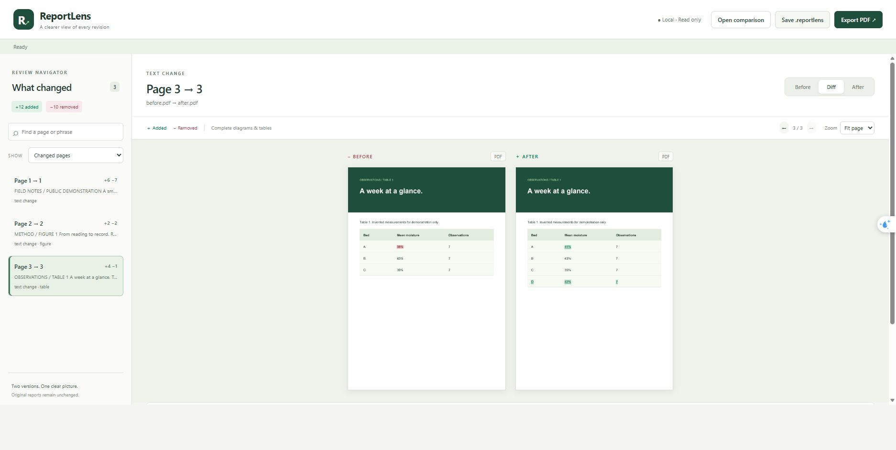

# ReportLens

**See what changed in your report, without searching through every page.**

ReportLens compares two committed report versions or two PDF files. Review them
in a local, read-only GUI, then share a portable comparison package or a diff PDF.
It is an independent tool: it does not depend on a particular report, embedded
project, or simulator.



## What you can do

- Switch between **Before**, **After**, and **Diff**.
- See added words in green with underlines, and removed words in red with strikethrough.
- Review **whole diagrams and tables** in their complete original page context.
  They are never reduced to changed cells or isolated fragments.
- Select any two available commits, in either order. By default, compare the
  latest report-changing commit with the preceding report-changing commit.
- Filter changed pages, text changes, figures/tables, or visual/layout changes;
  search page text and edits; zoom; use the arrow keys to navigate.
- Generate both outputs automatically when new report commits appear while the
  configured GUI is running. Notes-only commits are skipped according to your path filters.
- Open a `.reportlens` file without the source repository or a LaTeX installation.
- Export a **merged PDF** with unchanged prose once, red strikethrough removals,
  and green underlined additions in the same text. Body text uses 12-point type.

## Quick start

Requirements: **Python 3.11+** and a modern browser. Git and a LaTeX distribution
are needed only when rebuilding reports from committed LaTeX sources.

```sh
git clone https://github.com/J030104/Report-Lens.git
cd Report-Lens
python -m venv .venv
```

Activate the environment on Windows:

```powershell
.venv\Scripts\Activate.ps1
python -m pip install -e .
reportlens gui examples/public-demo/garden-review.reportlens
```

Or on macOS / Linux:

```sh
source .venv/bin/activate
python -m pip install -e .
reportlens gui examples/public-demo/garden-review.reportlens
```

The custom GUI opens in your browser and runs entirely on your computer. Keep
the terminal process running; press Ctrl+C to stop it. There is no hosted service,
account, telemetry, or report upload. This first release is a Python application,
not a packaged desktop installer.

On Windows, after installation you can double-click `Start-ReportLens.cmd`.
It opens your `local.reportlens.json` configuration if present, otherwise the
public demo. Drop a `.reportlens` file onto that launcher to open it directly.

The [public example](examples/public-demo) contains only an invented garden study.
It demonstrates prose edits, a changed workflow diagram, and a changed table.

## Connect a report repository

Copy `examples/reportlens.example.json` to `local.reportlens.json` in the project
root. Set `repository` to your report's Git checkout and `source` to the main
LaTeX file. Relative repository/output paths resolve from the configuration file;
source/output PDF paths resolve inside the committed snapshot.

```sh
reportlens gui --config local.reportlens.json
```

The initial comparison uses the latest two report-changing commits on the
configured ref's **first-parent history**. The selectors also expose recent
non-report commits. To compare any resolvable commit, branch, or tag directly:

```sh
reportlens compare --config local.reportlens.json --before v1 --after v2
```

For tracked PDF reports, set `source` to the PDF path and `tracked_paths` to its
path. No compiler is run. For LaTeX, `build_command` is a JSON array of arguments,
not a shell command; `{source}` becomes the source filename and the working
directory is its parent. The default runs pdfLaTeX three times with shell escape
disabled. You may instead configure a trusted local `latexmk`, XeLaTeX, or other
build command. Set `output_pdf` if the build writes somewhere other than beside
the source. Use an absolute compiler path if it is not on PATH.

Include all report dependencies (images, included chapters, bibliography, local
styles) in `tracked_paths`. A change outside those patterns does not trigger an
automatic comparison. Default patterns include common report assets; narrow
them if your repository also contains unrelated documents.

Git snapshots build in temporary directories. ReportLens never checks out a
revision in your working tree, stages files, commits, pushes, or edits your
report. Uncommitted changes are intentionally excluded. PDFs are cached by
commit and build configuration. Clear the output directory's `cache` folder
after changing compiler versions, installed fonts, or TeX packages.

## Automatic output

Monitoring is on by default with `gui --config ...`; turn it off using **Watch new
commits**, or launch with `--no-watch`. It polls the local ref every 15 seconds by
default. If several commits appear between polls, each gets a comparison against
the previous report-changing commit. It does not fetch GitHub, run while the app
is closed, or install a background service / Git hook. After a restart, the latest
pair is generated; offline history is available through the selectors or CLI.

```sh
# Generate the default outputs once, without starting the GUI.
reportlens compare --config local.reportlens.json

# Compare two existing PDFs, without Git or a compiler.
reportlens compare --before-pdf old.pdf --after-pdf new.pdf --output review

# Open the resulting portable package.
reportlens gui review/pdf-comparison.reportlens

# Keep the original alternating Before/After page layout instead.
reportlens compare --config local.reportlens.json --pdf-layout pages

# Export either layout from an existing package, without rebuilding the report.
reportlens export review/pdf-comparison.reportlens --output merged.pdf
reportlens export review/pdf-comparison.reportlens --output pages.pdf --pdf-layout pages
```

## Two output formats

| Output | Purpose |
| --- | --- |
| `.reportlens` | Self-contained ZIP-based package with both original PDFs, rendered pages, highlights, text edits, commit metadata, and the diff PDF. Open it in ReportLens on another computer. |
| `.pdf` | By default, a continuous merged reading copy of the complete report: unchanged prose once, with red removals and green additions inline. Changed visual regions retain their complete old and new versions. |

The GUI places complete pages side by side in Diff view; individual Before/After
views give more room. The default PDF reflows extracted text into larger, selectable
type; its page breaks, fonts and positioning differ from the source report.
Diagrams and tables remain images. A visual may move to the next sheet to keep it
whole. The GUI's **Export PDF** uses the selected launch layout, merged by default.
Opening an older package regenerates its export locally without modifying the input.

Use `--pdf-layout pages` with `compare`, `gui`, or `export` for the original
layout: a summary followed by complete Before/After images of changed page pairs
on consecutive sheets. Text within those images is not selectable. Both
original PDFs remain inside every comparison package. The package
format and its limits are documented in [docs/FORMAT.md](docs/FORMAT.md).

**Sharing a package shares both complete reports**, including unchanged pages.
Publish only material you have permission to share. Local output and personal
configuration files are ignored by Git; only synthetic examples belong in this
repository.

## How comparison works — and its limits

Text is extracted and matched across the whole document before pages are paired.
This reduces false replacements when a paragraph moves onto another page. Page
alignment is heuristic: a large rewrite, reordered chapters, columns, or a
one-to-many page split may produce imperfect pairing. Original pages remain
available so a reviewer can check the result.

Changed rendered pixels are classified as visual/layout changes when extracted
text has not changed. This includes figures, tables, spacing, font changes,
running headers, page numbers, and ordinary reflow. ReportLens does not claim
that every visual change is a substantive edit. Figure/table filters use caption
and PDF geometry hints; they are not perfect semantic detectors. The merged
export groups nearby drawing geometry into full-width visual regions, including
captions. Changes retain both complete regions rather than individual changed
cells. Unlocated captions and scanned pages fall back to complete page images;
text with unsupported font glyphs retains its original line image. Regions can
include surrounding material, and a shifted or resized region can be marked as
changed. There is no semantic figure recognition or multi-page table stitching.
Complex columns, formulas and PDF reading order may need inspection against the
originals. The merged reading copy does not mark every font or spacing change;
use the GUI or `--pdf-layout pages` for those visual details.

Image-only/scanned PDFs can be compared visually; no OCR is performed. A zero
word count does not mean a scanned report is unchanged. Identical raster output
and extracted text are considered unchanged even if invisible PDF metadata differs.
Limits: 500 pages per PDF, 300,000 extracted words total, 30 megapixels per rendered
page, 512 MB package upload, and 2 GB expanded package/snapshot size.

## Trust and privacy

The viewer binds only to `127.0.0.1`, requires a per-launch capability token, checks
Host/Origin, and loads no third-party scripts. Packages are validated against an
allowlist, size bounds, and SHA-256 checksums before extraction; checksums detect
damage, not the author's identity. Packages contain no executable build commands.

Only build source repositories and configure build commands you trust. The
temporary build directory and disabled TeX shell escape reduce accidental effects;
they are **not an operating-system sandbox**. A custom build command executes with
your user permissions. The viewer is not designed for internet hosting.

## Development and contributions

```sh
python -m unittest discover -s tests -v
python examples/make_demo.py
```

Tests exercise inserted/deleted pages, reflow, visual-only changes, complete visual
context, package integrity/traversal, read-only Git snapshots, default selection,
monitor catch-up, and local HTTP access boundaries. GitHub Actions runs these
checks on Windows and Linux. See [CONTRIBUTING.md](CONTRIBUTING.md).

Built with [pdfplumber](https://github.com/jsvine/pdfplumber),
[pypdfium2](https://github.com/pypdfium2-team/pypdfium2),
[Pillow](https://python-pillow.github.io/), and
[ReportLab](https://www.reportlab.com/opensource/).

ReportLens source is [MIT licensed](LICENSE). Dependencies retain their own licenses.
